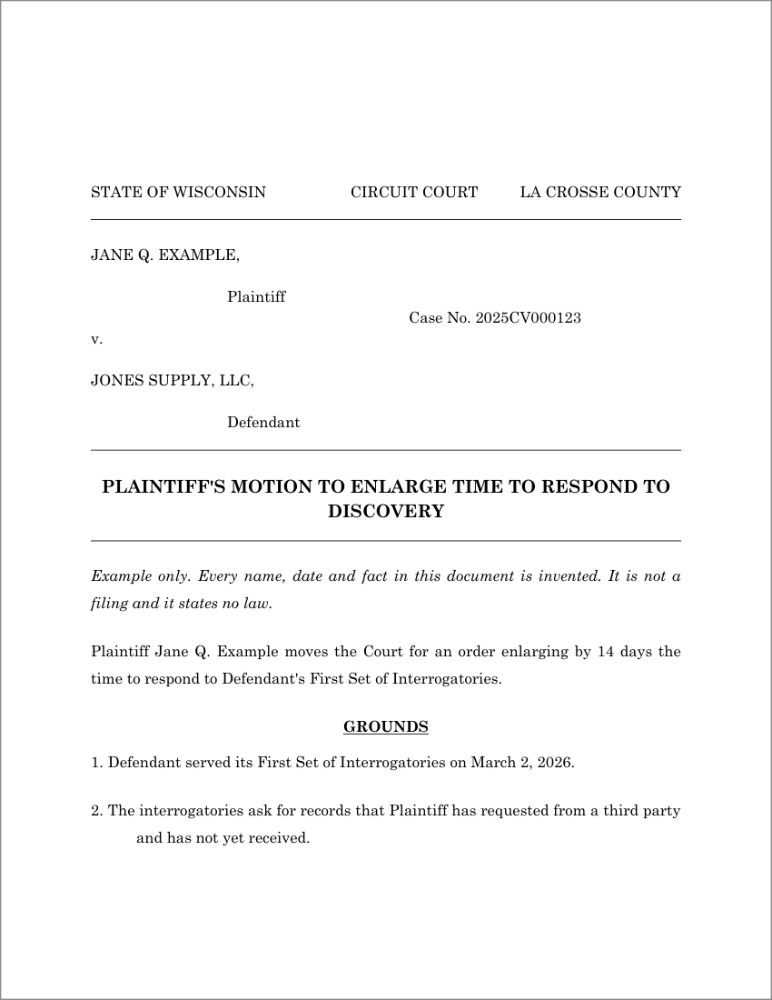
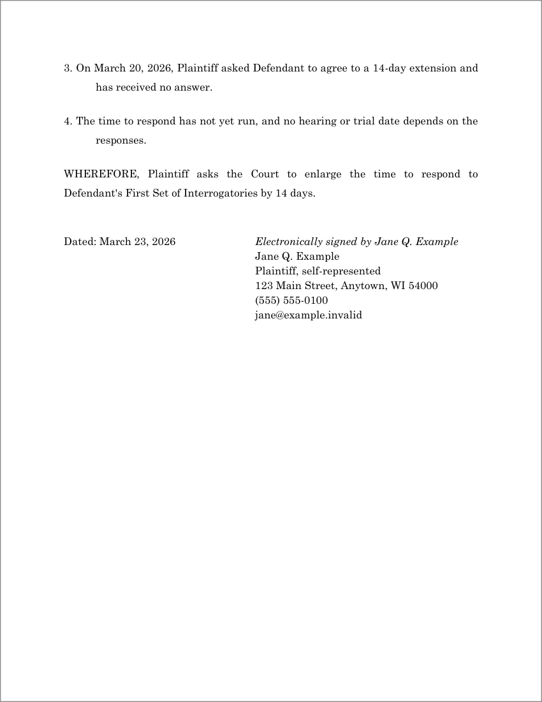

# Wisconsin Legal AI Skills

[](https://github.com/williamhorschak-dev/wisconsin-legal-ai-skills/actions/workflows/validate.yml)
[](LICENSE)
[](https://github.com/williamhorschak-dev/wisconsin-legal-ai-skills/releases/latest)

> **General information and software tools; no legal services.** William Horschak
> is **not a licensed attorney**. This project does not provide legal advice or
> representation from the maintainer. Using it or contacting him about it does not
> by itself create an attorney-client relationship. Do not submit confidential or
> case-specific information in public issues or pull requests.
> Read the [legal notice and support boundaries](LEGAL_NOTICE.md).

## What you can do with it

Three skills for AI assistants that work on Wisconsin court matters. Ask for the
task in plain words.

| Ask for | Skill | What the skill is written to produce |
|---|---|---|
| A circuit court motion, brief, discovery response, declaration or proposed order | [wisconsin-legal-writing](skills/wisconsin-legal-writing/SKILL.md) | An editable Word draft with caption, headings, numbered paragraphs and signature block, built by a script |
| A review of a filing you wrote | wisconsin-legal-writing | Prioritized corrections that keep your facts and requested relief |
| A letter to the court, an appellate brief or a research memo | wisconsin-legal-writing | Text that follows the supplied Word template. The builder script does not create these three |
| A check of the citations in a draft | [cite-check](skills/cite-check/SKILL.md) | A table of quotation, pinpoint and proposition checks against sources the session can read |
| What a Wisconsin statute or rule said on a date | [wisconsin-legal-interpretation](skills/wisconsin-legal-interpretation/SKILL.md) | The text, its version, the source, and what could not be confirmed |
| An analysis of a contested reading | wisconsin-legal-interpretation | A research memo under Wisconsin's own interpretive method, with adverse authority |

Results depend on your assistant and the sources it can reach. The project has no
recorded trial of any model on the current release.

### An example of the Word output

<p align="center">
  
  
</p>

The builder script made both pages from
[an invented specification](docs/examples/example-motion.json); Microsoft Word rendered
them. Download [the Word file](docs/examples/example-motion.docx). Every
name, date and fact in it is invented, and it states no law. The blank band at the top
of page 1 is the clearance the builder leaves for the court's filing stamp.

## What it does not do

- It is not a legal database and does not run a citator such as KeyCite or Shepard's.
  Your assistant and its tools have to supply source access.
- It does not advise on your case, calculate deadlines you can rely on, or decide that
  a document is ready to file. A passing test, lint, or build never establishes that.
- The builder makes circuit court captions only. It refuses complaints and summonses.
  A final build of a declaration or a motion needs a few structured fields, and the
  refusal names them.
- No attorney has reviewed any of it. AI reviewers checked the legal references
  against public sources.

**Audience.** The references are written around a self-represented civil litigant
in La Crosse and Trempealeau Counties. Check the rules of your own county and judge.

## What ships with each skill

- **cite-check:** `cite_check.py`, an evidence log tied to hashes of the draft and its
  sources, a quotation matcher and a report generator.
- **wisconsin-legal-writing:** `build_filing.py`, which builds a Word document from a JSON
  specification, with 11 specifications and 14 Word templates.
- **wisconsin-legal-interpretation:** `check_memo.py`, a structural linter for formal
  memos, and a memo template.

The scripts need Python 3.10 or later, and the builder needs `python-docx`.

## Set up

For Claude Code:

1. From the [latest release](https://github.com/williamhorschak-dev/wisconsin-legal-ai-skills/releases/latest),
   download the skill ZIPs you want and `SHA256SUMS.txt`.
2. Extract each ZIP into `.claude/skills/` in your project, or `~/.claude/skills/`
   for every project. Each ZIP holds one folder.
3. Ask for a task in plain words, or name the skill, for example `/cite-check`.

[SETUP.md](docs/SETUP.md) has the commands, the download and install checks, Codex, and
the prompt files for chat applications. Other hosts are untested.

## Try it

**Draft a motion.** Give the assistant your motion text and case information, and say:

> Use wisconsin-legal-writing to turn the supplied motion text and case information
> into an editable Wisconsin circuit court Word draft. Preserve the facts, citations,
> requested relief and signer. Use the appropriate caption, headings, paragraph
> numbering and signature block. Mark missing information and build in draft mode.
> Inspect the rendered pages if a renderer is available; otherwise say that
> inspection was not performed. Return the DOCX and a short list of unresolved checks.

**See the builder work without an assistant.** It needs Python and `python-docx`:

```sh
python -m pip install -r .claude/skills/wisconsin-legal-writing/requirements.txt
python .claude/skills/wisconsin-legal-writing/scripts/build_filing.py .claude/skills/wisconsin-legal-writing/assets/01-motion.json --draft -o motion-draft.docx
```

`--draft` allows unfilled placeholders. Without it the builder refuses placeholders,
protected-information number patterns and titles it does not support, and says why.
[SETUP.md](docs/SETUP.md) has one short invented example for each skill.

## What has been tested

- **Scripts.** A regression suite runs on Ubuntu and Windows with Python 3.10 and
  3.12 on every change.
- **Release files.** CI rebuilds them from the tagged commit, and they are compared
  byte for byte with the published files.
- **Word templates.** Rebuilt in tests and rendered in Microsoft Word.
- **Models.** No trial is recorded for the current release. Skill activation was
  measured in Claude Code on 2026-10-24. One exploratory evaluation was run on an
  earlier release.
- **Legal statements.** Not established as correct or current.

The figures and their limits are in
[TESTED-COMPATIBILITY.md](docs/TESTED-COMPATIBILITY.md) and
[TEMPLATE-QA.md](docs/TEMPLATE-QA.md).

## Limits and keeping current

The tools check what you and the assistant state. They do not verify facts or confirm
that anything was signed or filed. See [KNOWN-LIMITS.md](docs/KNOWN-LIMITS.md).

Wisconsin law changes by Act, court order, and decision. Statements stored in the
reference files carry the date they were checked and can be out of date. Two dated
cautions. The Wisconsin Supreme Court accepted review of whether to modify the
*Kalal* interpretive framework in *Abby Windows, LLC v. Labor & Industry Review
Commission*, No. 2024AP1013. Monetary limits in the references, including the
small-claims limit, are affected by 2025 Wis. Act 105, which takes effect on
January 1, 2027. Do not rely on any amount, deadline, or rule in a reference file
without reading the current primary text and its effective-date note. The
[source register](docs/legal-sources.json) lists what was checked and when.

## Contribute and get help

Support here is limited to software use, reproducible defects, general
documentation corrections, and feature suggestions. The maintainer does not choose
claims or remedies, calculate your deadlines, review your filings, or advise you
whether to file, settle, or appeal. Ask a lawyer licensed in the relevant place.

In issues, use fictional names and synthetic data, and do not post case files or
personal details. See [CONTRIBUTING.md](CONTRIBUTING.md), which has the commands for
working on the repository, and [SECURITY.md](SECURITY.md).

## Author and license

William Horschak is a nonlawyer software maintainer in Wisconsin, with a background
in operations management. He publishes these tools and general reference materials;
he does not provide legal services through this project.

- [Website](https://www.williamhorschak.com)
- [LinkedIn](https://www.linkedin.com/in/williamhorschak)
- [GitHub](https://github.com/williamhorschak-dev)

To cite this software, use the "Cite this repository" link on the GitHub page
([CITATION.cff](CITATION.cff)).

Licensed under [MIT](LICENSE). Each skill ZIP also includes the license and the
[legal notice](LEGAL_NOTICE.md).
